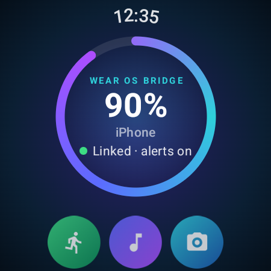
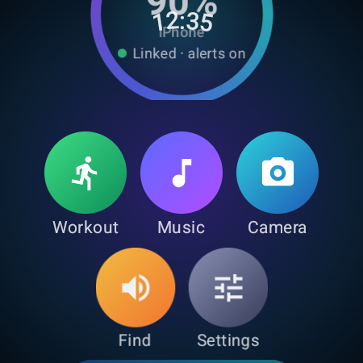
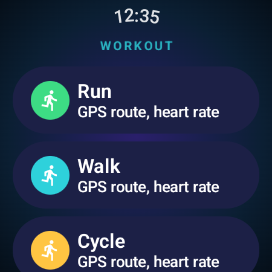
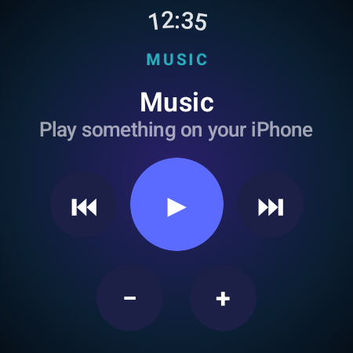
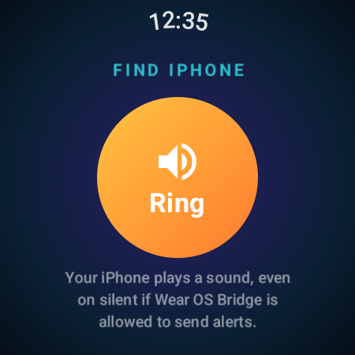
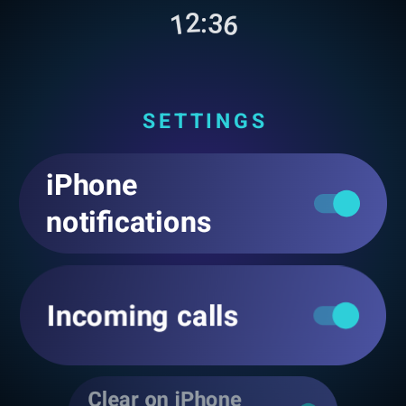
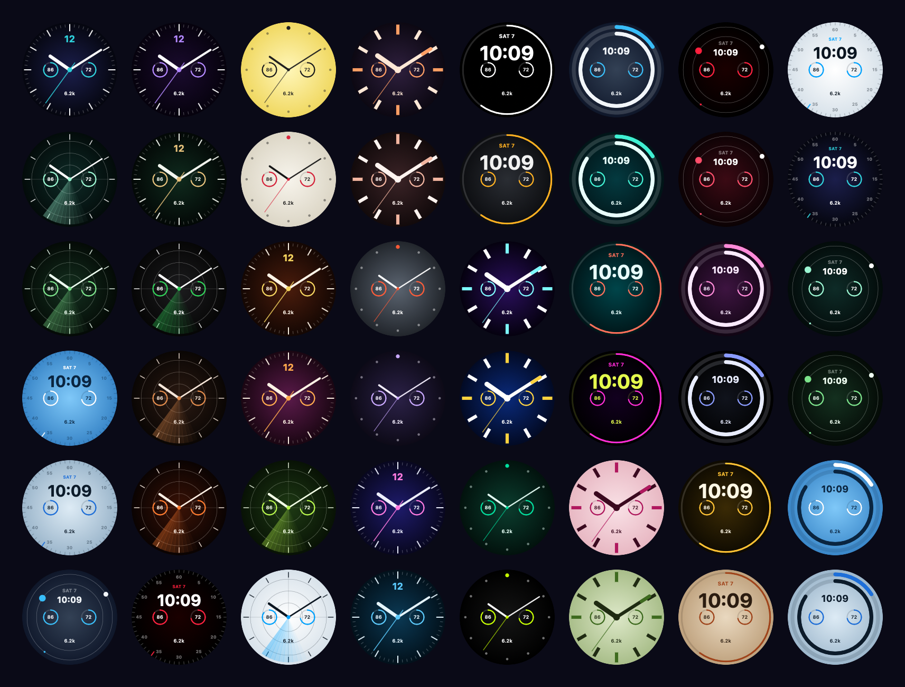

# Wear OS Bridge

Use a Wear OS watch (built and tested on a Samsung Galaxy Watch4 Classic) with an iPhone, with
as much as possible of what Galaxy Wearable does on Android: notifications, calls, Apple Health,
watch faces, apps, settings and more.

<p align="center">
  
  
  
</p>
<p align="center">
  
  
  
</p>

**320 free watch faces**, picked from the iPhone app and set on the watch:

<p align="center"></p>

## Download

From [Releases](../../releases):

- **`WearOSBridge-<version>.apk`**: the watch app. Install it with `adb install` (see below).
- **`WearOSBridge-<version>-unsigned.ipa`**: the iPhone app, unsigned. Sideload it with your own
  Apple ID using a tool such as Sideloadly or AltStore, or build it from source in Xcode.

| | |
|---|---|
| `watch-app/` | Wear OS app (Kotlin, Jetpack Compose for Wear, Tiles, a watch face) |
| `ios-app/` | iPhone companion app (SwiftUI) |
| `WearLink/` | Swift package with the shared protocol code and its tests |

Tested on a Galaxy Watch4 Classic (SM-R890, Wear OS 5 / One UI Watch 6) with an iPhone on iOS 26.

## Features

**Calls, notifications and messages**
- iPhone notifications on the watch, with their actions; clearing on one device clears on the other
- Per-app and per-type notification filters, set from the iPhone
- Incoming calls: answer or decline on the watch, and talk through the watch speaker and mic
- Make calls from the watch's Phone app through the iPhone; iPhone contacts copied to the watch

**Health and fitness → Apple Health**
- Heart rate, steps, active energy, distance and floors, recorded in the background
- Workouts (run, walk, cycle, hike, other) with GPS route and heart rate, saved as Apple Health workouts
- Readings are queued on the watch and deleted only after Apple Health confirms it stored them

**Watch faces**
- Face gallery: 320 free faces (8 layouts × 40 colour palettes). Tap one on the iPhone and it shows
  on the watch. Each has three complications you set from the watch's own face editor, and a
  low-power always-on mode
- The iPhone shows your watch with the face that's on it now, plus every installed face with previews
- Google Play inside the iPhone app: browse faces and watch apps, then tap **Install on watch**

**Apps, tiles and complications**
- See watch apps with their size, open them or uninstall them
- Tiles: calendar, reminders, weather, iPhone battery, now playing
- Complications: iPhone battery, weather, next event

**iPhone on the watch**
- Music controls with volume (also in the watch's own media controls)
- Camera remote with a live preview, flip and timer, or as a shutter for the stock Camera app
- Find my iPhone and find my watch
- Reminders, alarms and timers sent to the watch's Clock app
- Photos sent to the watch's Gallery; voice recordings copied from the watch

**Watch settings from the iPhone**
- Sound mode, volumes, ringtone and notification sound, brightness, screen timeout, font size,
  Do Not Disturb
- Always-on display, raise to wake, tap to wake, bezel wake, touch sensitivity, theatre mode,
  battery saver, water lock, bedtime mode
- Watch info: model, software, battery, storage; low watch battery alert

## Requirements and limits

- **The watch must already be set up** (with an Android phone, once). Pairing a freshly reset watch
  straight to an iPhone needs the Wear OS companion encryption layer, which isn't implemented yet;
  see [docs/NATIVE_PAIRING.md](docs/NATIVE_PAIRING.md), [HANDOFF.md](HANDOFF.md) and
  [research/PROTOCOL_NOTES.md](research/PROTOCOL_NOTES.md).
- **Watch faces:** Wear OS only lets Samsung's own software switch faces. The first time you pick
  a gallery face, choose **Wear OS Bridge** in the watch's face picker. After that, designs switch
  instantly. Faces from Google Play are installed from the iPhone but selected on the watch.
- Not possible for third-party apps on this watch: sending SMS (the watch has no Bluetooth message
  profile), SpO2/ECG/body composition (Samsung-only sensors) and setting the system clock.
- iPhone notifications on the watch need **Share System Notifications** turned on for the watch in
  iPhone Settings → Bluetooth → ⓘ.
- If another iPhone-bridge app is installed on the watch, turn off its notifications to avoid
  duplicates.

## Installing on the watch

Turn on **Developer options → Wireless debugging** on the watch, connect with `adb`, then:

```sh
adb install WearOSBridge-1.0.0.apk
```

Some features need one-time permissions that only `adb` can grant (they're optional; each feature
says when it's missing one):

```sh
P=nz.galaxybridge.watch
adb shell pm grant $P android.permission.WRITE_SECURE_SETTINGS   # display, gestures and modes
adb shell pm grant $P android.permission.DUMP                    # detect the active watch face
adb shell pm grant $P android.permission.PACKAGE_USAGE_STATS     # active face, app sizes
adb shell appops set $P GET_USAGE_STATS allow
adb shell appops set $P WRITE_SETTINGS allow                     # brightness, timeout, sounds
adb shell appops set $P SYSTEM_ALERT_WINDOW allow                # open Clock/Play Store from the iPhone
adb shell cmd notification allow_dnd $P                          # Do Not Disturb
adb shell dumpsys deviceidle whitelist +$P                       # stay connected in the background
adb shell settings put global hidden_api_policy 1                # call audio, forgetting the iPhone
```

## Pairing

1. On the watch, open Wear OS Bridge and tap **Pair iPhone** (the watch accepts a new phone for two minutes).
2. On the iPhone, open Wear OS Bridge, tap **Find my watch** and pick it.
3. Check the code matches on both screens and accept on both.

The iPhone only lists watches that are in pairing mode, and the watch only talks to the phone it
paired with.

## Building

### Watch app
Requires JDK 17+ and the Android SDK (compileSdk 35).

```sh
cd watch-app
./gradlew assembleDebug testDebugUnitTest
```

Release builds are signed when `tools/signing/keystore.properties` exists (kept out of git);
otherwise `assembleRelease` produces an unsigned APK.

### iPhone app
Requires Xcode 16+ (iOS 17 or later on the phone). Open `ios-app/GalaxyBridge.xcodeproj`, choose
your own signing team, and run on a device. With a free Apple ID the app has to be reinstalled
every 7 days.

### Tests
```sh
cd WearLink && swift test
cd watch-app && ./gradlew testDebugUnitTest
```

## Security and privacy

- All traffic uses the OS Bluetooth stack's authenticated LE Secure Connections pairing (numeric
  comparison); there is no custom cryptography.
- Every message from the other device is strictly validated (types, sizes, ranges, timestamps) before
  use; malformed input is dropped.
- The iPhone app only **writes** to Apple Health; it never reads your existing health data.
- No accounts, analytics or servers. Network use: the optional weather lookup (location rounded to
  about 1 km, sent to [Open-Meteo](https://open-meteo.com)) and Google Play pages you open yourself,
  which are browsed without signing in and keep no cookies.
- Calendar events, contacts and photos go only to your watch.

## Disclaimer

Not affiliated with or endorsed by Google, Samsung or Apple. "Wear OS", "Galaxy" and "Google Play"
are trademarks of their owners. Health readings are informational and not for medical use. Use at
your own risk.

## License

[MIT](LICENSE)
